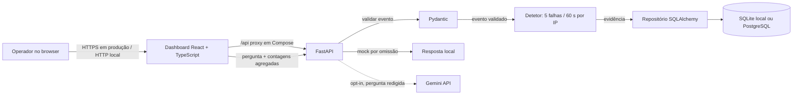

# Arquitetura do SentinelAI

SentinelAI é um protótipo educativo para demonstrar ingestão de eventos de
autenticação, uma regra determinística de deteção e uma interface de análise.
Não é um SIEM de produção e um alerta não prova que ocorreu um ataque.

## Componentes

## Percurso dos dados

1. `POST /events` valida timestamp com fuso horário, endereço IP, nome não vazio
   e resultado (`failed` ou `success`). Campos extra são rejeitados.
2. O serviço guarda o evento e recalcula sequências cronológicas por IP dentro de
   uma transação. Cinco falhas numa janela inclusiva de 60 segundos produzem um
   alerta com os timestamps e as contas observadas.
3. Uma impressão digital única evita persistir a mesma sequência várias vezes.
4. O dashboard consulta eventos e alertas, e deixa o operador pesquisar,
   filtrar, exportar os eventos visíveis e abrir a evidência do alerta.
5. O assistente é opcional. O modo padrão não faz chamadas externas. Se Gemini
   estiver ativo, o backend envia a pergunta depois de mascarar formatos comuns
   de IP, email e credenciais, além de contagens agregadas. Não envia a tabela de
   eventos. A redação é uma proteção de melhor esforço, não uma garantia contra
   toda a divulgação acidental; perguntas livres podem incluir nomes ou outros
   dados que o filtro não reconheça.

## Fronteiras de confiança e limites

- Eventos recebidos são dados não confiáveis: validação e deteção não executam
  conteúdo do evento.
- A chave Gemini pertence apenas ao ambiente do backend, nunca ao bundle React.
- Compose publica portas só em `127.0.0.1`; isso é adequado para demonstração
  local, não para um serviço público.
- Nginx acrescenta `X-Content-Type-Options`, `X-Frame-Options` e `Referrer-Policy`
  às respostas do dashboard; isto é endurecimento básico, não uma CSP completa.
- O token de operador é partilhado e opcional em desenvolvimento. Em `APP_ENV`
  de produção, a API recusa endpoints protegidos quando não há token configurado.
- Ainda faltam contas individuais, controlo de acesso por utilizador, rate
  limiting, monitorização operacional e uma configuração de alojamento validada.
- SQLite serve para desenvolvimento e demonstração. PostgreSQL é suportado por
  `DATABASE_URL`, mas não foi provisionado nem testado num serviço gerido.

## Decisões

- A regra de deteção é determinística e independente do LLM para que a IA não
  decida se um evento é malicioso.
- SQLAlchemy separa consultas da base de dados da API; Alembic mantém o esquema
  versionado.
- SQLite torna o arranque local simples; PostgreSQL fica disponível para uma
  implantação futura sem reescrever os modelos.
- Nginx serve o frontend e encaminha `/api` internamente para o backend no
  Compose, evitando expor o serviço interno do backend ao browser.
- A chave Bearer é mantida em memória no browser e desaparece ao recarregar a
  página; isto reduz persistência local, mas não substitui uma sessão de login.
